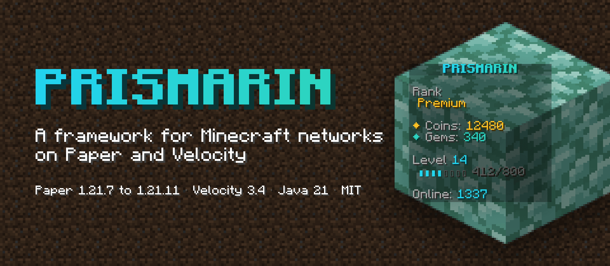
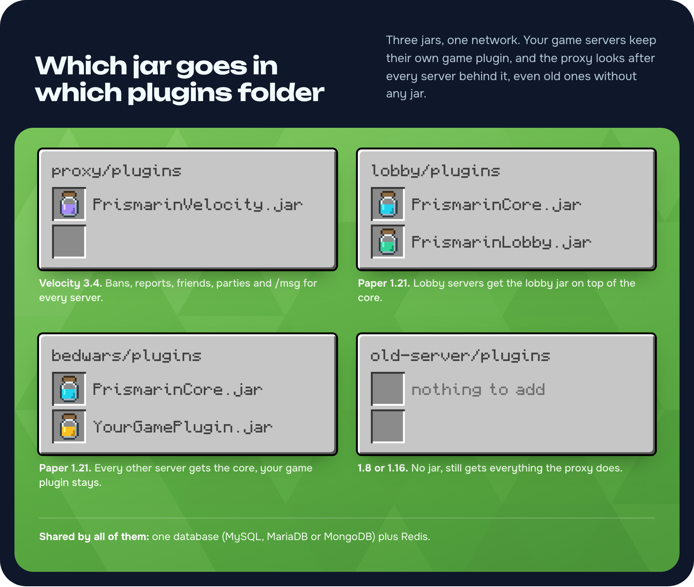
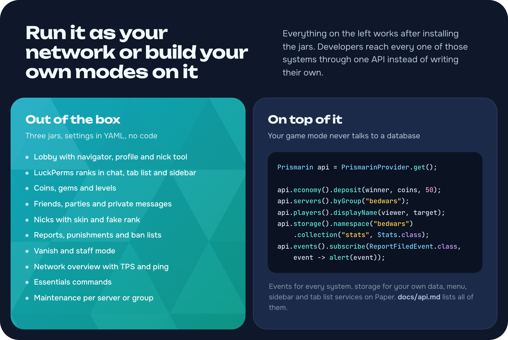
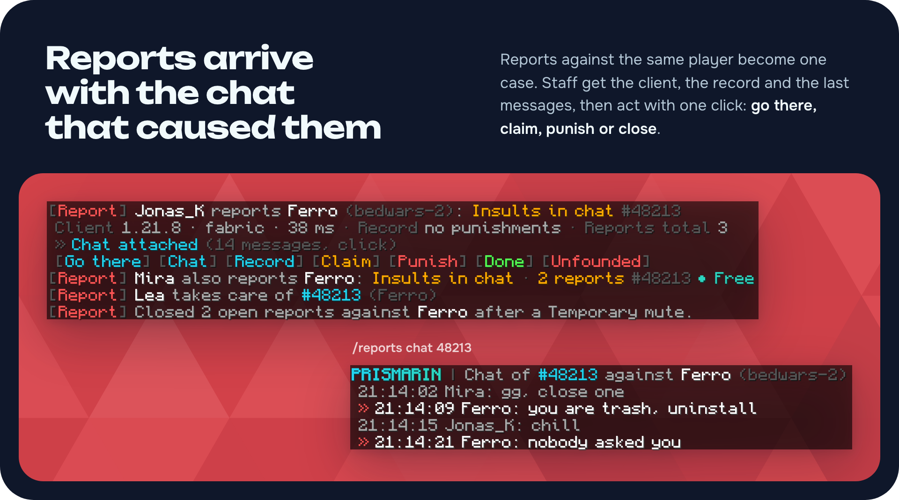
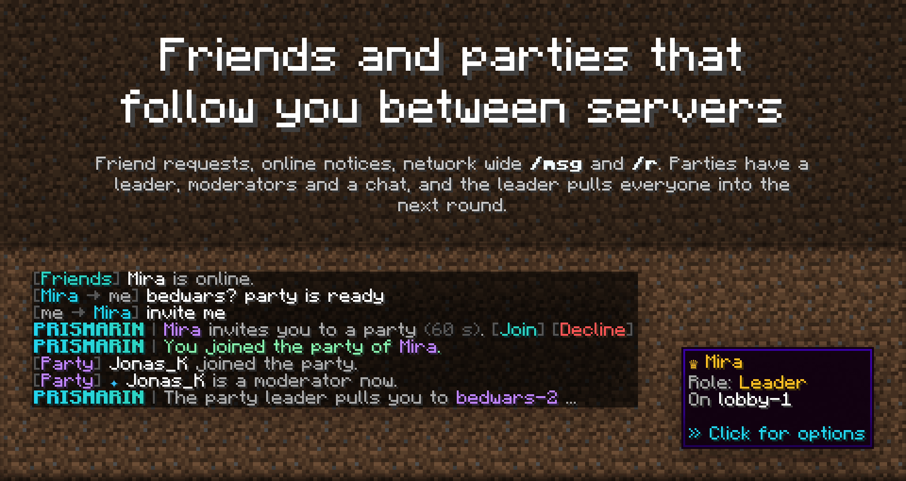
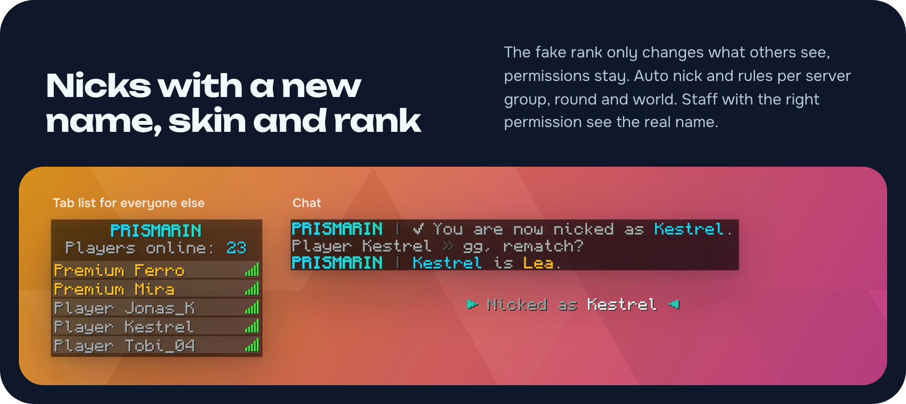
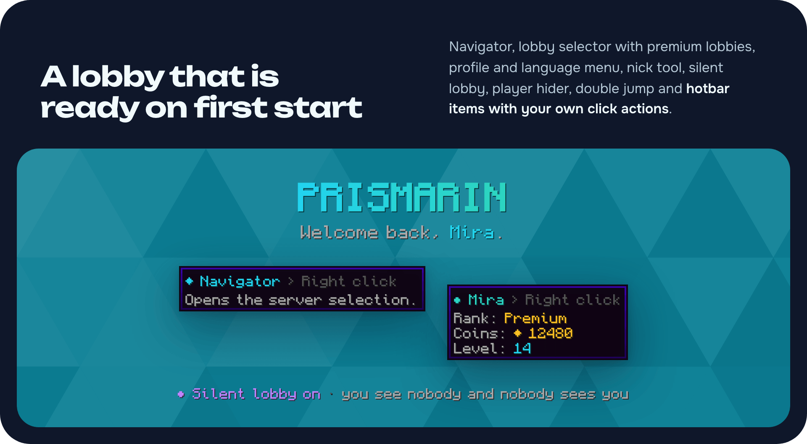
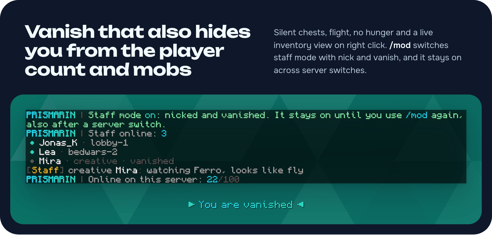

PRISMARIN is a framework for Minecraft networks on Paper and Velocity. Installed on its own it is a complete network system: lobby, ranks, currencies, friends, parties, nicks, reports and moderation. Next to your existing plugins it becomes the shared layer they connect to, so a BedWars plugin can pay out network coins, show its game state in the navigator and nick players per round.

Every system can be switched off, every text lives in YAML with MiniMessage, `&` codes and hex colours, and every feature has a public API with events.



## Installation

1. Download the ZIP and unpack it. It holds three jars:
   * `velocity/PrismarinVelocity.jar` for the Velocity proxy
   * `paper/PrismarinCore.jar` for every Paper server
   * `paper/PrismarinLobby.jar` for lobby servers only, next to PrismarinCore

   The single jars are also on the [GitHub releases](https://github.com/LeonManuel0705/prismarin/releases).
2. Start everything once. Each server writes its `config.yml` and adds new options on later updates by itself.
3. With more than one backend, set `storage.mode` to `MYSQL`, `MARIADB` or `MONGO` on all servers and turn on `redis.enabled`. A single test server runs on JSON files or SQLite without any database.

Optional: LuckPerms for ranks, Vault or VaultUnlocked for other plugins' economy, PlaceholderAPI in both directions.



## Features

The pictures recreate the in-game views with PRISMARIN's default English texts.

### Reports and punishments



* `/report` opens a menu with the reasons from `admin.yml`, offline players can be reported too
* Reports against the same player become one case, several reporters mark it as urgent
* Chat and spam reports carry the recent chat around the reported player as evidence
* Staff see client version, ping and record and act with one click: go there, claim, punish, close
* `/reports` opens a staff menu with filters, sorting and claims that free themselves after a set time
* Punishment templates escalate on repeat offences, a punishment closes open reports and thanks the reporters
* Bans, temporary bans, IP bans, mutes, kicks and warnings, `/check`, history, `/banlist`, `/mutelist` and an audit log

### Friends and parties



* Friend requests, online notices, jumping to a friend's server and settings for who may contact you
* Parties with leader, moderators and members, party chat, invites and a leader who pulls everyone to the next server
* Network wide `/msg` and `/r`, social spy for staff
* All of it also in the lobby profile menu

### Nicks



* Name and skin change on every server, with a fake rank that keeps the real permissions
* Auto nick and rules per server group, per round and per world, nether and end follow their overworld
* `/nick`, `/unnick`, `/realname` and a nick tool in the lobby hotbar
* Other players only see the nick, also when they report the nicked player

### Lobby



* Navigator with server groups and live game states
* Several lobby worlds or lobby servers with balancing, plus premium lobbies
* Profile menu with rank, currencies, level, friends, party and language
* Nick tool, silent lobby, player hider, double jump and void teleport
* Hotbar items with your own click actions

### Staff tools



* Vanish in the style of SuperVanish: hidden from the tab list, the player count and `/list`, silent chests, mobs ignore you, flight and no hunger
* Right click a player while vanished to watch their inventory, armour and offhand live
* `/mod` turns on staff mode with nick and vanish, and it stays on across server switches
* Staff chat, `/team`, `/find`, `/goto`, `/send`, `/netexec` and maintenance per server or group
* `/network` shows status, players, ping, TPS, memory and uptime of every server

### Everything else

* Currencies the network defines itself, each with its own balance command, registered with Vault and VaultUnlocked
* Levels and XP with `/level`
* LuckPerms prefixes, suffixes, display names and chat colours in chat, tab list and sidebar, `/rank` with durations
* Game states from the API or from a placeholder of any game plugin, `/play <group>` picks the best free server
* Essentials commands such as `/tpall`, `/heal`, `/fly`, `/gm` and `/invsee` that step aside when EssentialsX or CMI is installed
* Tab list, sidebar and chat format switch off by themselves when TAB or another scoreboard or chat plugin is found
* German and English included, another language is one more `messages_<tag>.yml`
* Network name, colours and chat prefix come from the config
* `/prismarin migrate` moves all data from one storage backend to another

## For developers

Every system is reachable from other plugins: players, economy, levels, vanish, staff mode, nicks, friends, parties, reports, punishment templates, storage, audit log, maintenance and staff notifications, plus sidebar, tab list, chat and menu services on Paper.

```kotlin
repositories {
    maven("https://jitpack.io")
}

dependencies {
    compileOnly("com.github.LeonManuel0705:prismarin:v1.0.4")
}
```

```java
Prismarin prismarin = PrismarinProvider.get();

prismarin.economy().deposit(winner, prismarin.economy().primaryCurrency(), 50);
prismarin.events().subscribe(ReportFiledEvent.class, event -> alert(event.report()));
```

Add `depend: [PrismarinCore]` to your `plugin.yml`. The full list of services and events is in [docs/api.md](https://github.com/LeonManuel0705/prismarin/blob/main/docs/api.md), and the `example-paper` module is a complete plugin built only on the API.

## Compatibility

| Part | Supported |
|:---|:---|
| Backends | Paper 1.21.7 to 1.21.11 and forks based on it. Spigot, Bukkit and Folia are not supported. |
| Proxy | Velocity 3.4 |
| Java | 21 or newer |
| Clients | Whatever the proxy accepts. With ViaVersion, ViaBackwards and ViaRewind, 1.21 and 1.16.5 clients were tested. 1.8 clients need worlds between Y 0 and 255. |
| Older backends | A 1.8 or 1.16 server behind the proxy keeps every proxy feature. Menus, nicks, vanish and the sidebar need PRISMARIN on the server itself. |
| Storage | MySQL 5.7+, MariaDB, MongoDB, SQLite or JSON files, Redis or a Redis compatible server |

## Links

* Source code and issues: [github.com/LeonManuel0705/prismarin](https://github.com/LeonManuel0705/prismarin)
* API reference: [docs/api.md](https://github.com/LeonManuel0705/prismarin/blob/main/docs/api.md)
* License: MIT
