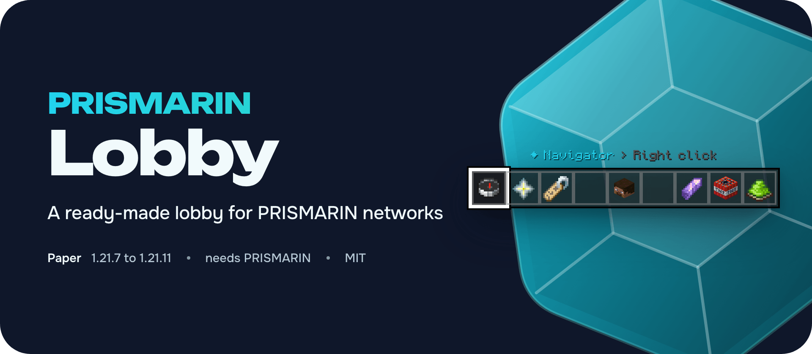
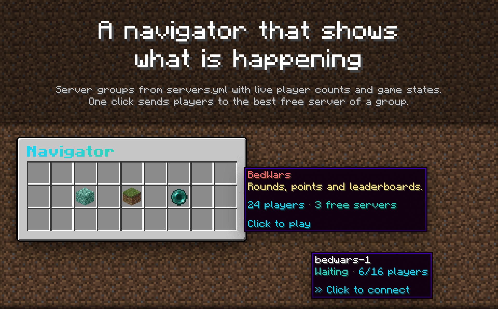
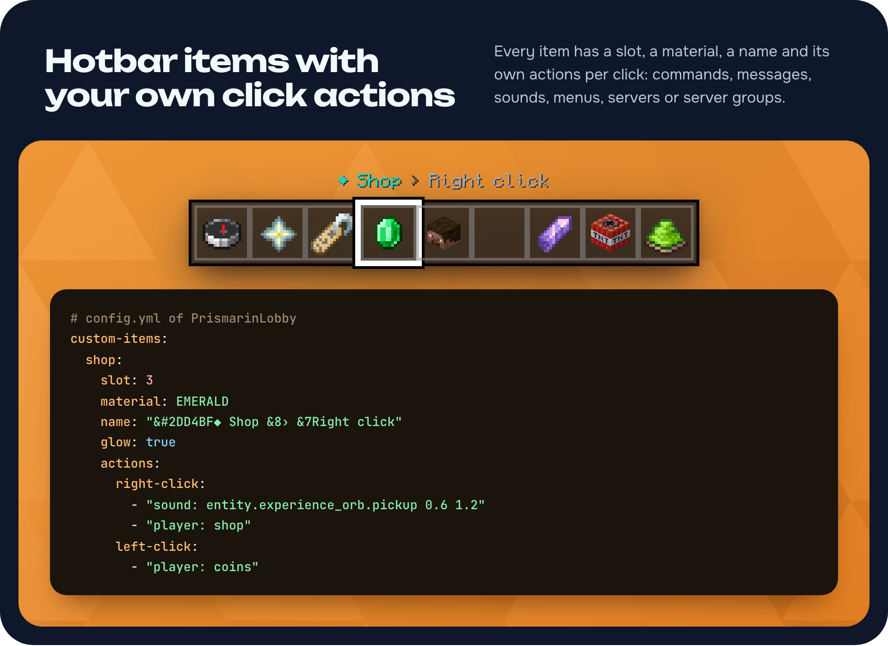
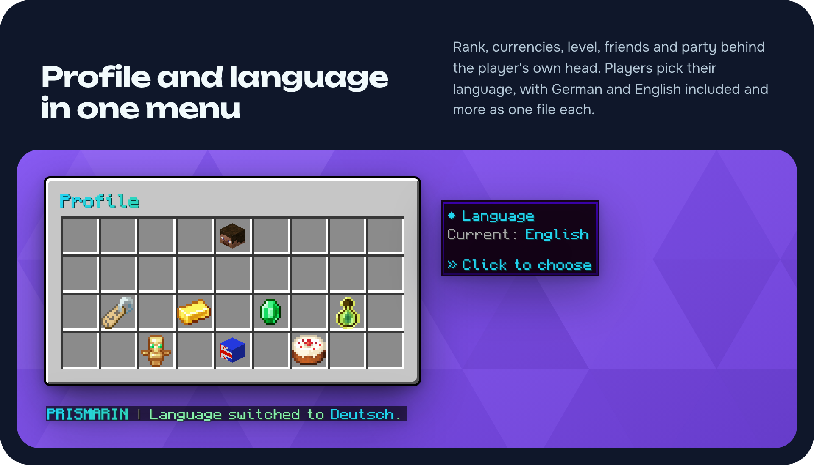

PRISMARIN Lobby is the ready-made lobby for PRISMARIN networks. Put it next to PRISMARIN on your lobby servers and players get a navigator, their profile, a language menu, a nick tool and a quiet place to wait. Every item, menu and text is set in YAML, and every part can be switched off.

## Features

* Navigator with the server groups from servers.yml, live player counts and game states, one click to the best free server
* Several lobby worlds or lobby servers with balancing, premium lobbies and a lobby selector
* Nick tool, silent lobby, player hider, double jump and void teleport
* Welcome title on the first join of a session, not on every server switch

* Every hotbar item can be moved, renamed, switched off or replaced
* Your own items with actions per click: player or console commands, messages, action bar texts, menus, servers, server groups, lobbies and sounds

* Profile menu behind the player's own head with rank, currencies, level, friends, party, clan, stats and the daily reward
* Floating leaderboards placed with `/leaderboard create`, a cosmetics chest in the hotbar and JoinMe invites in the navigator
* `/lobbybuild` (or `/build`) puts the lobby items away for building and gives them back afterwards
* Language menu with German and English included, another language is one more messages file

## Installation

1. Install PRISMARIN first: PrismarinCore on every Paper server, PrismarinVelocity on the proxy.
2. Put `PrismarinLobby.jar` into the plugins folder of each lobby server and start it once.
3. Stand where players should appear and run `/setspawn`, then `/setvoid <height>` for the void teleport.

## Commands and permissions

| Command | Permission | Default |
|:---|:---|:---|
| `/lobbybuild [player]`, alias `/build` | `prismarin.lobby.build`, `prismarin.lobby.build.others` | op |
| `/leaderboard create\|remove\|move\|list` | `prismarin.lobby.leaderboard` | op |
| `/setspawn [clear]` | `prismarin.lobby.setspawn` | op |
| `/setvoid <height\|here\|off> [world]` | `prismarin.lobby.setvoid` | op |
| Premium lobbies | `prismarin.lobby.premium` | nobody |
| Silent lobby item | `prismarin.lobby.silent` | op |

## For developers

`net.prismarin.lobby.api.LobbyService` lets other plugins add hotbar items and entries to the navigator, profile and lobby selector, open lobby menus, send players to a lobby or its spawn, and listen to `LobbyEnteredEvent` and `LobbyLeftEvent`. The full reference is in [docs/modules/lobby.md](https://github.com/LeonManuel0705/prismarin/blob/main/docs/modules/lobby.md).

## Requirements

Paper 1.21.7 to 1.21.11, Java 21 and PRISMARIN 1.1.0 or newer on the same server. MIT licensed, source code: https://github.com/LeonManuel0705/prismarin
