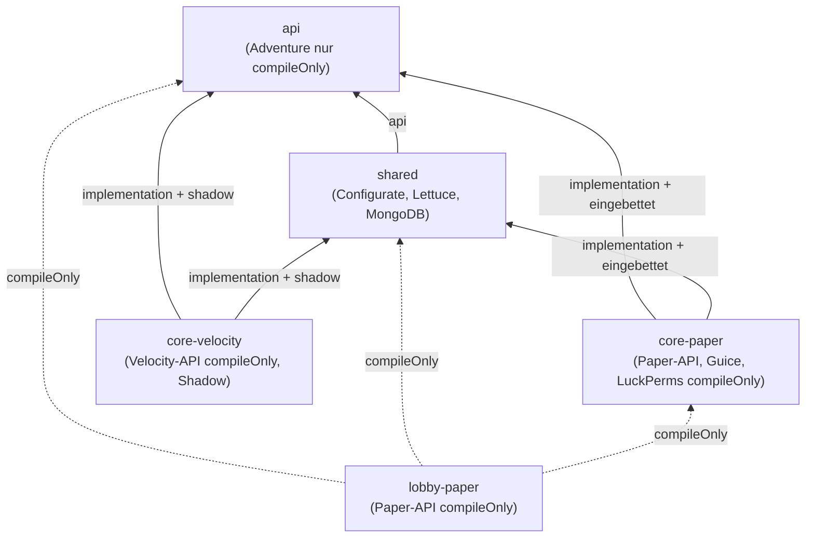
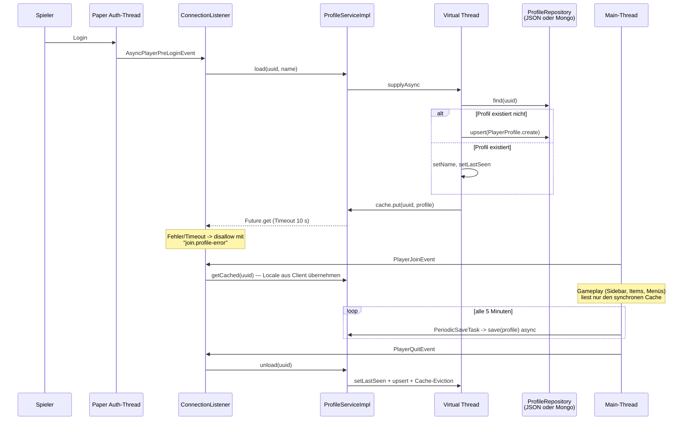

# PRISMARIN — Architektur

Monorepo für das PRISMARIN-Netzwerk: ein Velocity-Proxy vor mehreren Paper-Backends, gemeinsame Dienste für Profile, Economy, Cross-Server-Messaging und Lokalisierung. Gradle 9 (Kotlin DSL), Java 21 (`options.release = 21`), Group `net.prismarin`, Version `0.1.0`.

## Modulübersicht

| Modul | Rolle | Artefakt |
| --- | --- | --- |
| `:api` | Plattformneutrale Verträge (Interfaces, Records, `Brand`) | wird in `PrismarinCore.jar` und `PrismarinVelocity.jar` eingebettet |
| `:shared` | Implementierungen der API: Config, Storage, Messaging, Locale | dito |
| `:core-paper` | Kern-Plugin für alle Paper-Backends | `dist/PrismarinCore.jar` |
| `:core-velocity` | Kern-Plugin für den Velocity-Proxy | `dist/PrismarinVelocity.jar` (Shadow) |
| `:lobby-paper` | Lobby-Gameplay, hängt zur Laufzeit an PrismarinCore | `dist/PrismarinLobby.jar` |
| `build-logic` | Convention-Plugin `prismarin.java` (Java 21, JUnit 5, Integrationstest-Split) | included build |



Durchgezogene Kanten landen im Jar des abhängigen Moduls, gestrichelte Kanten sind reine Compile-Abhängigkeiten: `lobby-paper` bekommt alle Klassen zur Laufzeit vom PrismarinCore-Plugin-Classloader.

## Laufzeit-Topologie

Velocity-Proxy plus drei Paper-Backends (Namen, Ports und Kategorien aus `core-paper/src/main/resources/servers.yml`):

```mermaid
graph TD
    P((Spieler)) --> V["Velocity-Proxy<br/>PrismarinVelocity.jar<br/>MOTD, Wartung, /hub, /sendall,<br/>Lobby-Fallback bei Kick"]

    subgraph Backends [Paper-Backends]
        L["lobby · 127.0.0.1:25566 · LOBBY<br/>PrismarinCore + PrismarinLobby"]
        C["creative · 127.0.0.1:25567 · BUILD<br/>PrismarinCore"]
        M["minigame · 127.0.0.1:25568 · GAME<br/>PrismarinCore"]
    end

    V --> L
    V --> C
    V --> M

    subgraph LOCAL [Profil LOCAL — heutiger Live-Betrieb]
        J["JSON-Dateien je Server<br/>plugins/PrismarinCore/profiles/&lt;uuid&gt;.json<br/>LocalMessageBus (nur In-Process)"]
    end

    subgraph MONGO [Profil MONGO + Redis — Ziel-Setup]
        DB[("MongoDB<br/>Collection profiles")]
        R[("Redis Pub/Sub<br/>RedisMessageBus")]
    end

    L -. storage.mode .-> J
    L -. "storage.mode=MONGO<br/>redis.enabled=true" .-> DB
    L -.-> R
    C -.-> DB
    M -.-> DB
    C -.-> R
    M -.-> R
```

Der Storage-Modus ist pro Server über `config.yml` wählbar (`shared/config/ConfigLoader`):

- **LOCAL** (Default): `JsonFileProfileRepository` schreibt Profile als JSON-Dateien mit Stripe-Locking und atomarem Move; `LocalMessageBus` verteilt Nachrichten nur innerhalb des Prozesses. Kein geteilter Zustand zwischen Servern.
- **MONGO + Redis**: `MongoProfileRepository` (Collection `profiles`, atomare `findOneAndUpdate`-Inkremente) plus `RedisMessageBus` (Lettuce Pub/Sub, Gson-serialisierte `NetworkMessage`-Envelopes). Voraussetzung für jede Cross-Server-Funktion. Der Infrastruktur-Stack dafür liegt in `infra/docker-compose.yml` (MongoDB, Redis, MariaDB reserviert, Prometheus, Grafana).

Der Lobby-Navigator wechselt Server über Plugin-Messages auf dem `BungeeCord`-Channel (`lobby/server/ServerConnector`), den Velocity nativ versteht.

## Classloader-Strategie

Drei unterschiedliche Mechanismen, damit keine Bibliothek doppelt oder inkompatibel geladen wird:

1. **PrismarinCore als Library-Host (Paper).** `core-paper/src/main/resources/plugin.yml` deklariert unter `libraries:` Guice, mongodb-driver-sync, lettuce-core und configurate-yaml/-core. Paper lädt diese Maven-Artefakte beim Serverstart in den Plugin-Classloader — sie stecken nicht im Jar. Die Projekte `:api` und `:shared` werden dagegen über die `includedProjects`-Configuration als `zipTree` direkt in `PrismarinCore.jar` eingebettet (`core-paper/build.gradle.kts`).
2. **Abhängige Paper-Module (z. B. `lobby-paper`).** Deklarieren `depend: [PrismarinCore]` in ihrer `plugin.yml` und bauen gegen `compileOnly(project(":api"))`, `compileOnly(project(":shared"))`, `compileOnly(project(":core-paper"))`. Zur Laufzeit delegiert Papers `PluginClassLoader` an die Classloader der Abhängigkeiten, sodass `PrismarinLobby.jar` schlank bleibt und exakt dieselben Klasseninstanzen (Guice-Singletons, `CoreApi`) sieht wie der Core.
3. **Velocity-Shadow.** `core-velocity` shadowt `api`, `shared` und alle Runtime-Bibliotheken in `prismarin-velocity.jar` und relociert sie nach `net.prismarin.libs.*` (configurate, geantyref, kyori-option, snakeyaml, lettuce, netty, reactor, reactivestreams), um Kollisionen mit den von Velocity gebündelten Versionen zu vermeiden. Der MongoDB-Treiber wird ausgeschlossen — der Proxy nutzt keine Profil-Persistenz.

Der `dist`-Task im Root-Build sammelt die drei Jars unter `dist/` als `PrismarinCore.jar`, `PrismarinLobby.jar` und `PrismarinVelocity.jar`.

Service-Zugriff über Modulgrenzen läuft ausschließlich über `net.prismarin.core.CoreApi`: PrismarinCore registriert dort seinen Guice-Injector bei `onEnable` und entfernt ihn bei `onDisable`; abhängige Plugins bauen sich mit `CoreApi.get().injector().createChildInjector(...)` einen Child-Injector mit eigenen Bindings (siehe `lobby/LobbyPlugin` + `LobbyModule`).

## Threading-Modell

- **Virtual-Thread-Executor.** `CoreModule` bindet einen Singleton `ExecutorService` aus `Executors.newVirtualThreadPerTaskExecutor()`. `ProfileServiceImpl` und `EconomyServiceImpl` erzeugen sich denselben Executor-Typ selbst. Jede Datenbank- und Datei-Operation läuft als `CompletableFuture` auf virtuellen Threads — nie auf dem Main-Thread.
- **Main-Thread-Regeln.** Bukkit-API wird aus async Threads nicht angefasst; nach abgeschlossenen Futures wird mit `Bukkit.getScheduler().runTask(plugin, ...)` zurückgesprungen (Beispiele: `EconomyCommand.handleTransfer`, `LobbyMenus.switchLocale`, `SetSpawnCommand`). Einzige dokumentiert-sichere Ausnahmen: `AsyncPlayerPreLoginEvent` feuert auf dem Auth-Thread, dort ist blockierendes Warten (`get` mit 10 s Timeout) erlaubt; `Player#sendMessage`/Adventure-Audiences sind thread-sicher, `EconomyCommand.send` prüft dennoch `Bukkit.isPrimaryThread()`.
- **Periodik.** `PeriodicSaveTask` läuft alle 5 Minuten (`20 * 60 * 5` Ticks) auf dem Main-Thread, stößt aber nur asynchrone `ProfileService.save`-Futures an. `SidebarManager` aktualisiert alle 10 Ticks, `TablistManager` alle 100 Ticks — beides reine Main-Thread-Arbeit auf gecachten Daten.
- **Shutdown.** `PrismarinCorePlugin.onDisable` flusht alle Online-Profile mit 15 s Timeout, schließt danach `ProfileStorage`, `MessageBus` und den Executor. Velocity fährt in `onProxyShutdown` MessageBus und Executor herunter.

## Profil-Datenfluss



Schreibzugriffe für Offline-Spieler laufen über `ProfileService.modify` (Cache-Hit oder Storage-Fallback, danach Upsert). Economy-Transaktionen umgehen den Profil-Cache und arbeiten atomar auf dem Repository (`incrementCurrency` mit `INSUFFICIENT_FUNDS`/`PROFILE_NOT_LOADED`-Semantik); `EconomyCommand` synchronisiert den Cache nach erfolgreicher Transaktion zurück.
